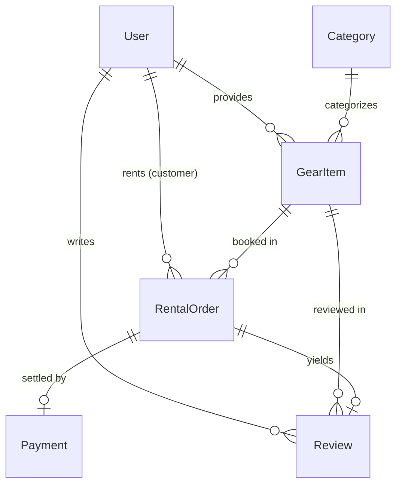

# 🏋️ GearUp Backend API — Rent Sports & Outdoor Gear Instantly


**GearUp** is a backend REST API for a sports and outdoor equipment rental service. The platform connects gear providers with sports enthusiasts, offering end-to-end rental order management, inventory control, automated role-based access control (RBAC), customer reviews, and integrated Stripe payments.

---

## 🔗 Live Links & Documentation

| Resource | URL |
| :--- | :--- |
| **🚀 Live Server Base URL** | [https://gearup-backend-q7w4.onrender.com](https://gearup-backend-q7w4.onrender.com) |
| **📖 Interactive Swagger API Docs** | [https://gearup-backend-q7w4.onrender.com/api-docs](https://gearup-backend-q7w4.onrender.com/api-docs) |
| **🏥 Server Health Check** | [https://gearup-backend-q7w4.onrender.com/](https://gearup-backend-q7w4.onrender.com/) |

---

## 🔑 Default Administrator Credentials

On initial server startup, an administrator account is automatically seeded into the database:

- **Email:** `admin@gearup.com`
- **Password:** `admin123`
- **Role:** `ADMIN`

---

## 👥 Roles & Permissions Matrix

| Role | Key Capabilities |
| :--- | :--- |
| **CUSTOMER** | • Browse & filter sports equipment<br>• Place rental orders with custom date ranges<br>• Make secure online payments via Stripe<br>• Track rental order status<br>• Leave reviews and ratings for returned gear |
| **PROVIDER** | • Manage gear inventory (Add, Edit, Delete listings)<br>• Manage stock and pricing per day<br>• View incoming customer rental orders<br>• Update order lifecycle (`CONFIRMED`, `PICKED_UP`, `RETURNED`) |
| **ADMIN** | • View and moderate all registered users (Suspend / Activate accounts)<br>• Manage equipment categories<br>• Oversee all gear listings and rental transactions platform-wide |

---

## 🛠️ Technology Stack

- **Runtime & Language:** Node.js, TypeScript
- **Web Framework:** Express 5.x
- **Database & ORM:** PostgreSQL (Neon Serverless DB) via Prisma ORM 7.x
- **Authentication & Security:** JWT (Access & Refresh Tokens), bcryptjs, Cookie-Parser, CORS
- **Payments:** Stripe SDK (`PaymentIntents` + Webhook event handling)
- **API Documentation:** Swagger UI (`swagger-ui-express` + OpenAPI 3.0 specification)
- **Build System:** `tsup` bundler (ESM output)
- **Deployment Platform:** Render Web Service

---

## 📊 Database Schema Overview

The database schema is powered by Prisma ORM and consists of 6 primary models:



1. **User:** User credentials, profile data, status (`ACTIVE` / `BLOCKED`), and role (`CUSTOMER`, `PROVIDER`, `ADMIN`).
2. **Category:** Classification for gear (e.g., Cycling, Camping, Water Sports, Winter Sports).
3. **GearItem:** Gear listing specifications, daily rental pricing, brand, condition, stock availability, and provider reference.
4. **RentalOrder:** Booking details, rental start/end dates, total pricing calculation, and status progression (`PLACED` ➔ `CONFIRMED` ➔ `PAID` ➔ `PICKED_UP` ➔ `RETURNED` / `CANCELLED`).
5. **Payment:** Stripe transaction tracking, `paymentIntentId`, amount, currency, and payment status (`PENDING`, `COMPLETED`, `FAILED`, `REFUNDED`).
6. **Review:** Customer ratings (1–5 stars) and comments on rented equipment.

---

## 🚀 API Endpoints Reference

Explore and test all endpoints interactively at the live Swagger UI: **[`/api-docs`](https://gearup-backend-q7w4.onrender.com/api-docs)**.

### 1. 🔐 Authentication (`/api/auth`)
| Method | Endpoint | Access | Description |
| :--- | :--- | :--- | :--- |
| `POST` | `/api/auth/register` | Public | Register customer or provider account |
| `POST` | `/api/auth/login` | Public | Login with email & password, receive tokens |
| `POST` | `/api/auth/refresh-token` | Public | Generate new Access Token using Refresh Token |
| `GET` | `/api/auth/me` | Authenticated | Retrieve authenticated user's profile |

### 2. 👤 User Management (`/api/users`)
| Method | Endpoint | Access | Description |
| :--- | :--- | :--- | :--- |
| `GET` | `/api/users/profile` | Authenticated | Get current user profile details |
| `PATCH` | `/api/users/profile` | Authenticated | Update user name, phone, or address |

### 3. 📂 Categories (`/api/categories`)
| Method | Endpoint | Access | Description |
| :--- | :--- | :--- | :--- |
| `GET` | `/api/categories` | Public | List all gear categories with gear count |
| `POST` | `/api/categories` | Admin | Create a new gear category |
| `PATCH` | `/api/categories/:id` | Admin | Update category name/description |
| `DELETE` | `/api/categories/:id` | Admin | Delete a category |

### 4. 🏕️ Gear Catalog (Public & Provider)
| Method | Endpoint | Access | Description |
| :--- | :--- | :--- | :--- |
| `GET` | `/api/gear` | Public | Browse gear with search, category & price filters |
| `GET` | `/api/gear/:id` | Public | Retrieve detailed gear specifications & reviews |
| `POST` | `/api/provider/gear` | Provider | Add new gear item to inventory |
| `GET` | `/api/provider/gear` | Provider | List all gear owned by logged-in provider |
| `PATCH` | `/api/provider/gear/:id` | Provider | Update gear details, price, or stock |
| `DELETE` | `/api/provider/gear/:id` | Provider | Remove gear listing from inventory |

### 5. 📦 Rental Orders (`/api/rentals` & `/api/provider/orders`)
| Method | Endpoint | Access | Description |
| :--- | :--- | :--- | :--- |
| `POST` | `/api/rentals` | Customer | Place a rental order with date range |
| `GET` | `/api/rentals` | Customer | View customer rental booking history |
| `GET` | `/api/rentals/:id` | Authenticated | View detailed order breakdown |
| `PATCH` | `/api/rentals/:id/cancel` | Customer | Cancel an unconfirmed order |
| `GET` | `/api/provider/orders` | Provider | View incoming orders for provider gear |
| `PATCH` | `/api/provider/orders/:id` | Provider | Advance order status (`CONFIRMED`, `PICKED_UP`, `RETURNED`) |

### 6. 💳 Payments (`/api/payments`)
| Method | Endpoint | Access | Description |
| :--- | :--- | :--- | :--- |
| `POST` | `/api/payments/create-intent` | Customer | Create Stripe PaymentIntent for confirmed order |
| `POST` | `/api/payments/confirm` | Customer | Confirm completed payment |
| `POST` | `/api/payments/webhook` | Stripe | Webhook endpoint for automated Stripe event handling |
| `GET` | `/api/payments/order/:orderId`| Authenticated | Get payment transaction details for an order |

### 7. ⭐ Reviews (`/api/reviews`)
| Method | Endpoint | Access | Description |
| :--- | :--- | :--- | :--- |
| `POST` | `/api/reviews` | Customer | Submit review after gear has been returned |
| `GET` | `/api/reviews/gear/:gearId` | Public | Get all customer reviews for a specific gear |

### 8. 🛡️ Admin Operations (`/api/admin`)
| Method | Endpoint | Access | Description |
| :--- | :--- | :--- | :--- |
| `GET` | `/api/admin/metrics` | Admin | Dashboard summary metrics (Users, Orders, Revenue) |
| `GET` | `/api/admin/users` | Admin | List all registered users with filters |
| `PATCH` | `/api/admin/users/:id/status`| Admin | Update user status (`ACTIVE` or `BLOCKED`) |
| `GET` | `/api/admin/orders` | Admin | View platform-wide rental orders |

---

## 💻 Local Development Setup

### 1. Prerequisites
- **Node.js** (v20.x or higher)
- **PostgreSQL** database (local or Neon DB instance)
- **npm** or **yarn**

### 2. Clone and Install Dependencies
```bash
git clone <repository-url>
cd <repository-folder>
npm install
```

### 3. Setup Environment Variables
Create a `.env` file in the root directory:
```env
PORT=5000
DATABASE_URL="postgresql://<user>:<password>@<host>/<database>?sslmode=require"
APP_URL="http://localhost:3000"

BCRYPT_SALT_ROUNDS=10

JWT_ACCESS_SECRET="your_jwt_access_secret_key"
JWT_REFRESH_SECRET="your_jwt_refresh_secret_key"
JWT_ACCESS_EXPIRES_IN="1d"
JWT_REFRESH_EXPIRES_IN="7d"

STRIPE_SECRET_KEY="sk_test_your_stripe_secret_key"
STRIPE_WEBHOOK_SECRET="whsec_your_stripe_webhook_secret"
```

### 4. Push Database Schema
```bash
npx prisma db push
```

### 5. Run the Server
```bash
# Start in development mode with live watch
npm run dev

# Or build and run production bundle
npm run build
npm run start
```
The server will start at `http://localhost:5000`. Access Swagger UI at `http://localhost:5000/api-docs`.

---

## ☁️ Deployment Guide (Render)

1. Create a new **Web Service** on [Render](https://dashboard.render.com).
2. Connect your GitHub repository.
3. Configure the build and start settings:
   - **Environment:** `Node`
   - **Build Command:** `npm install && npm run build`
   - **Start Command:** `npm run start`
4. Add all environment variables in Render's **Environment** tab:
   - `DATABASE_URL`
   - `JWT_ACCESS_SECRET`
   - `JWT_REFRESH_SECRET`
   - `JWT_ACCESS_EXPIRES_IN`
   - `JWT_REFRESH_EXPIRES_IN`
   - `STRIPE_SECRET_KEY`
   - `STRIPE_WEBHOOK_SECRET`
   - `APP_URL`
   - `NODE_ENV=production`
5. Click **Deploy Web Service**.

---

## 📝 License
This project is licensed under the ISC License.
